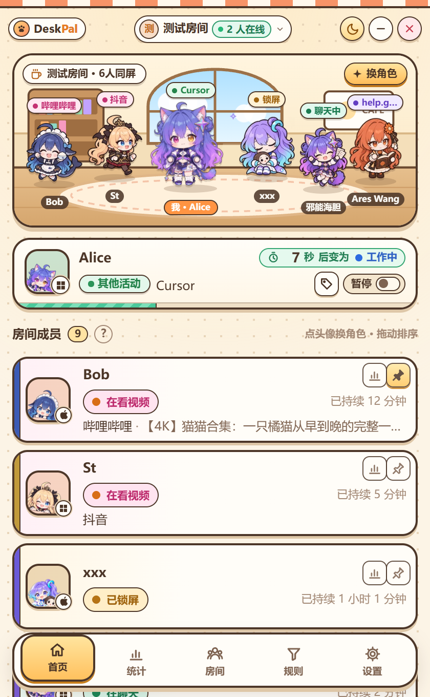
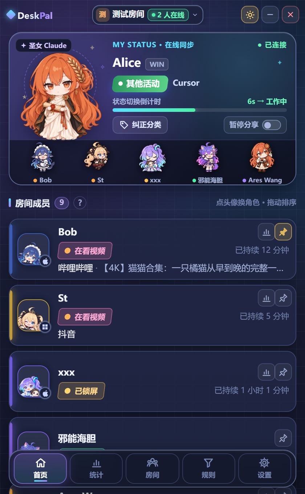
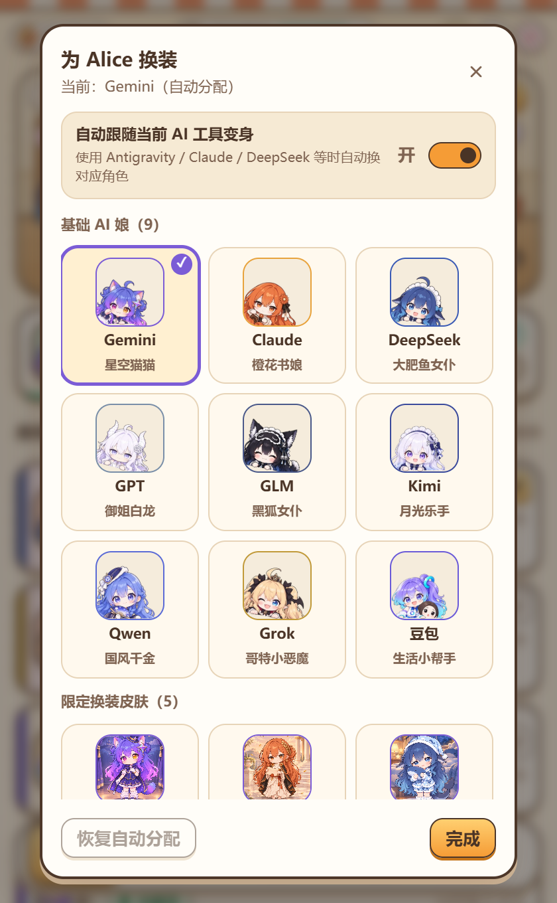
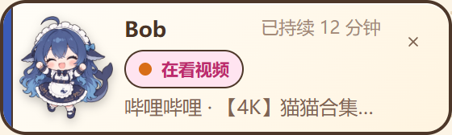
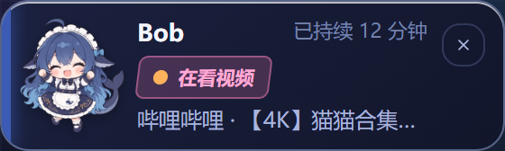

# DeskPal Chibi UI · 双主题手游风皮肤

面向 [DeskPal](https://github.com/HuLuShiLei/DeskPal) 的社区双主题 Q 版手游风界面皮肤（兼容 DeskPal `v0.1.5 ~ v0.1.6`），完整保留 DeskPal 全部 7 个页面功能（首页、统计、房间、规则、设置/插件、登录页、桌面置顶小卡片）。

| 浅色模式 · 奶油手账自习室 | 深色模式 · 星夜二次元大厅 | 角色与限定换装选择器 |
| :---: | :---: | :---: |
|  |  |  |

| 桌面置顶 Q 版小卡片（浅色） | 桌面置顶 Q 版小卡片（深色） |
| :---: | :---: |
|  |  |

---

## 特性亮点

- **双色手游主题一键切换**：标题栏右上角内置月亮/太阳快捷按钮，同步 DeskPal 浅色/深色设置：
  - **浅色（奶油手账 · 云吸猫自习室）**：暖奶油点阵底纹 + 咖啡厅棚檐 + 60fps 窗外飘云 + 6 人同屏 Q 版自习室 + 底部悬浮蜜糖金导航栏。
  - **深色（星夜档案 · 二次元手游大厅）**：深空星夜网格 + 缓慢旋转星轨 + 看板娘大立绘舞台 + 底部房友 Q 版排排站长凳 + 暗色毛玻璃底部导航栏。
- **零拖影真逐帧动画 + 摸摸头互动**：
  - 房友小人使用 20 帧 `mini.webp` 精灵条做整数像素原地切帧（工作记笔记/搬砖、浏览翻书、聊天招手、娱乐蹦跶、暂离睡觉），清晰不糊；
  - 主角大立绘采用双图预加载交叉淡入 + 脚底锚定柔和呼吸 + 60fps 状态伴随特效；点击主角可触发 Q 弹「摸摸头」并冒爱心。
- **14 套 Q 版 AI 娘角色与限定换装**：
  - 内置 9 位基础角色（Gemini / Claude / DeepSeek / GPT / GLM / Kimi / Qwen / Grok / 豆包）+ 5 套限定皮肤（魔术师 Gemini、圣女 Claude、睡衣 DeepSeek、卫衣 DeepSeek、龙崽 GPT）；
  - 点击「换角色」或任意成员头像即可自由指定角色（保存于本机 `localStorage`，不改服务端）；支持开启「自动跟随当前 AI 工具变身」。

---

## 普通用户快速安装（无需 Node.js）

1. 前往本仓库右侧 **[Releases](../../releases/latest)** 下载最新的 `DeskPal-Chibi-UI-vX.Y.Z-win.zip` 并解压到任意文件夹。
2. 托盘右键**退出 DeskPal**，双击解压目录中的 **`一键安装皮肤.cmd`**（会自动探测 DeskPal 安装目录，并先将原版界面备份为 `web.official.bak`）。
3. 重新打开 DeskPal 即可生效！

- **随时恢复原版**：退出 DeskPal，双击 **`一键还原原版.cmd`**。
- **官方客户端更新后**：DeskPal 通过 Velopack 自动更新时会重建 `current\` 目录，更新后再双击一次 `一键安装皮肤.cmd` 即可重新套用皮肤。

---

## 开发者构建与发版

需要 Node.js 20.19+：

```powershell
# 安装依赖
npm ci

# 浏览器模拟宿主开发预览（http://localhost:5192/?theme=light&crowd 或 ?theme=dark&crowd）
npm run dev

# 构建静态皮肤包到 dist/
npm run build

# 打包 Windows 分发 zip 到 release/DeskPal-Chibi-UI-vX.Y.Z-win.zip
npm run package:release

# 本机开发快捷应用 / 还原
npm run apply:deskpal
npm run restore:deskpal

# 从本地 CrossPet 仓库重新同步角色素材（可选）
node scripts/sync-chibi-assets.mjs <本地 CrossPet 仓库>/characters
```

推送 `vX.Y.Z` 标签（例如 `git tag v0.1.0 && git push origin v0.1.0`）会自动触发 `.github/workflows/release.yml` 构建并发布 GitHub Release 压缩包。

---

## 致谢与授权

- **皮肤代码与构建脚本**：遵循 [MIT License](LICENSE)。
- **Q 版角色立绘与精灵素材（`public/chibi/`）**：源自 [CrossPet](https://github.com/lokicorvus/crosspet) 及社区二创作者，遵循 **[CC BY-NC-SA 4.0](public/chibi/LICENSE.md)**（署名、**非商业性使用**、相同方式共享）。严禁用于商业用途。
- **宿主通信协议与基础页面骨架**：适配自 [DeskPal](https://github.com/HuLuShiLei/DeskPal)。
